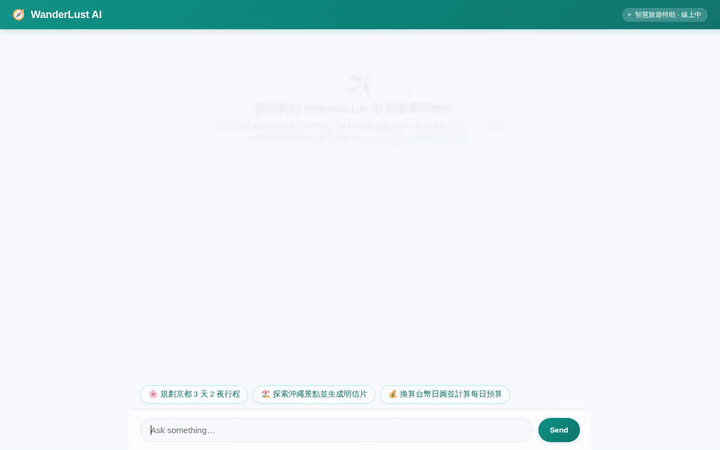

# ✈️ WanderLust AI (智慧旅遊規劃特助)

> An intelligent, multi-tool travel concierge built with the **Google Agent Development Kit (ADK)** and deployed on **Google Cloud Agent Platform**. It crafts personalized itineraries, searches curated destinations, queries live weather and exchange rates, and generates travel postcards and scenery videos on demand.

<div align="center">



</div>

---

## 🌟 Overview & Capabilities

**WanderLust AI** is an agent-first travel assistant designed to guide travelers from inspiration to day-by-day itinerary planning. Rather than returning plain text walls, the agent reasons across multiple tools, queries structured Firestore catalogs, executes secure code in a sandbox, and responds with interactive **A2UI (Agent-to-User Interface)** visual cards.

### What the Agent Actually Does:
- 🗺️ **Personalized Itinerary Planning**: Crafts day-by-day travel schedules balancing sightseeing, dining, and travel pacing.
- 🏛️ **Attraction Catalog & Details**: Searches curated points of interest and retrieves full descriptions, ratings, and recommended visit durations from Firestore.
- 💾 **Itinerary & Attraction Storage**: Allows travelers to save custom itineraries and contribute new favorite hidden gems directly into Firestore.
- 🌤️ **Live Destination Weather**: Fetches real-time temperatures, wind speeds, humidity, and weather conditions worldwide.
- 💱 **Real-time Currency Conversion**: Computes real-time exchange rates across global currencies for trip budgeting.
- 📍 **Geocoding & Nearby Discovery**: Converts landmarks into geographic coordinates and searches nearby restaurants, cafes, and attractions via Google Maps & Places APIs.
- 🖼️ **Travel Postcard Generation**: Generates custom scenery images and postcards using Google's `gemini-3.1-flash-lite-image` model, saving artifacts and uploading to Cloud Storage.
- 🎥 **Cinematic Destination Video Generation**: Creates short preview videos of travel destinations using Google's Omni model (`gemini-omni-flash-preview`).
- 🧮 **Sandbox Code Execution**: Runs Python code inside Vertex AI Agent Engine Sandbox for exact budget breakdowns and scheduling math.
- 🧠 **Cross-Session Memory**: Proactively recalls traveler preferences, travel styles, and dietary restrictions across conversations.

---

## 🧩 Wired Google Cloud Services & Architecture

Based directly on the codebase (`app/agent.py` and `agents-cli-manifest.yaml`), the following Google Cloud services and tools are implemented and wired up:

| Layer | Service / Model | Role in WanderLust AI |
|---|---|---|
| 🤖 **Reasoning Core** | **Google ADK + `gemini-3.8-flash`** | Core agent reasoning loop with automated retries and system prompt engineering. |
| 🧠 **Long-Term Memory** | **Vertex AI Memory Bank** | `PreloadMemoryTool` injects traveler preferences at turn start; `after_agent_callback` extracts durable preferences to `VertexAiMemoryBankService`. |
| 🗄️ **Structured Database** | **Cloud Firestore** | Stores attraction records (`attractions` collection) and saved itineraries (`itineraries` collection). |
| 🖼️ **Media Storage** | **Cloud Storage** | Public bucket for hosting generated travel postcards and destination preview clips. |
| 🎨 **Image Generation** | **Vertex AI `gemini-3.1-flash-lite-image`** | Generates photorealistic travel postcards from text prompts via Google GenAI SDK. |
| 🎬 **Video Generation** | **Google Omni (`gemini-omni-flash-preview`)** | Produces destination scenery preview videos via GenAI Interactions API. |
| 🧪 **Secure Code Sandbox** | **Agent Engine Sandbox Code Executor** | Executes Python code in a remote sandboxed environment for currency calculations and scheduling computations. |
| 🪟 **Agent-first UI** | **A2UI (v0.8 Basic Catalog)** | Formats agent responses into structured cards, columns, rows, and embedded images via `a2ui_callback`. |
| 🌐 **Frontend Proxy** | **FastAPI + A2A Protocol** | Bridges browser clients to Agent Engine over the Agent-to-Agent (A2A) protocol with built-in A2UI rendering. |

---

## 🔧 Implemented Tools Reference

The agent's toolbelt in `app/agent.py` includes 12 dedicated tools:

1. `search_attractions(city, category, query)`: Queries Firestore for matching travel attractions.
2. `get_attraction_details(attraction_id)`: Retrieves full details of a specific attraction from Firestore.
3. `add_attraction(...)`: Adds a new attraction or point of interest to the Firestore catalog.
4. `save_travel_itinerary(...)`: Persists a structured travel plan into Firestore.
5. `convert_currency(amount, from_currency, to_currency)`: Converts currency using live exchange rates from Open Exchange Rates API.
6. `get_live_weather(city)`: Fetches real-time weather, temperature, and conditions via Open-Meteo API.
7. `geocode_address(address)`: Converts addresses and landmark names into latitude/longitude via Google Maps Geocoding API.
8. `find_nearby_places(latitude, longitude, place_type, radius_meters)`: Discovers nearby spots via Google Places API (New).
9. `generate_destination_image(prompt)`: Generates destination images with `gemini-3.1-flash-lite-image`, saves artifacts, and uploads to Cloud Storage.
10. `generate_destination_video(prompt)`: Generates cinematic destination videos with `gemini-omni-flash-preview`, saves artifacts, and uploads to Cloud Storage.
11. `get_current_time(query)`: Resolves destination time zones and current local times.
12. `PreloadMemoryTool()`: Automatically loads persisted traveler profile facts into context at each turn start.

---

## 📁 Project Structure

```
wanderlust-ai/
├── app/
│   ├── agent.py               # Main agent logic, tool definitions, and AdkApp wiring
│   ├── a2ui_utils.py          # A2UI callback and surface schema manager
│   ├── fast_api_app.py        # ADK FastAPI backend application
│   └── app_utils/             # Shared helpers
├── frontend/
│   ├── main.py                # FastAPI proxy speaking A2A protocol
│   ├── requirements.txt       # Frontend proxy dependencies
│   ├── Dockerfile             # Container definition for frontend deployment
│   └── static/
│       └── index.html         # Responsive chat UI with native A2UI card renderer
├── scripts/
│   └── seed_firestore.py      # Firestore catalog seeder script
├── agents-cli-manifest.yaml   # Project manifest for agents-cli deployment
├── pyproject.toml             # Agent dependencies (ADK, vertexai, google-cloud)
└── demo.gif                   # Looping recorded demo of the agent in action
```

---

## 🚀 Setup & Local Execution

### Prerequisites

- Python 3.10+
- [`uv`](https://docs.astral.sh/uv/) package manager
- Google Cloud SDK (`gcloud`) authenticated with a project having Vertex AI, Firestore, and Cloud Storage enabled:
  ```bash
  gcloud auth application-default login
  gcloud config set project <YOUR_PROJECT_ID>
  ```

### 1. Run the Agent Locally

You can test the agent locally using the ADK development playground:

```bash
# Navigate to the agent directory
cd wanderlust-ai

# Install dependencies
uv sync

# Launch the ADK development playground
uv run adk web
```

### 2. Run the Custom Frontend Locally

The project includes a lightweight FastAPI proxy and chat UI that connects to the deployed Agent Engine via A2A:

```bash
cd frontend

# Install frontend dependencies
pip install -r requirements.txt

# Set required environment variables
export AGENT_ENGINE_RESOURCE_NAME="projects/<PROJECT_NUMBER>/locations/<LOCATION>/reasoningEngines/<ENGINE_ID>"
export AGENT_DIRECTORY="app"

# Optional: set external API keys if testing maps locally
export GOOGLE_MAPS_API_KEY="<YOUR_GOOGLE_MAPS_API_KEY>"

# Start the frontend server
python main.py
```

The frontend will start on port `8080` (or the port specified by the `PORT` environment variable).

---

## 🚢 Deployment

### Deploy Agent to Vertex AI Agent Engine

Using `agents-cli`:

```bash
agents-cli deploy
```

### Deploy Frontend to Cloud Run

The frontend includes a production-ready `Dockerfile` and can be built and deployed directly to Google Cloud Run:

```bash
cd frontend

gcloud builds submit --tag gcr.io/<YOUR_PROJECT_ID>/wanderlust-frontend

gcloud run deploy wanderlust-frontend \
  --image gcr.io/<YOUR_PROJECT_ID>/wanderlust-frontend \
  --platform managed \
  --region us-east1 \
  --allow-unauthenticated \
  --set-env-vars AGENT_ENGINE_RESOURCE_NAME="projects/<PROJECT_NUMBER>/locations/<LOCATION>/reasoningEngines/<ENGINE_ID>",AGENT_DIRECTORY="app"
```

Ensure the Cloud Run runtime service account is granted `roles/aiplatform.user` so it has permission to invoke the deployed Agent Engine.

---

## 📄 License

Apache License 2.0. Built with Google Cloud Agent Platform and Google ADK.

